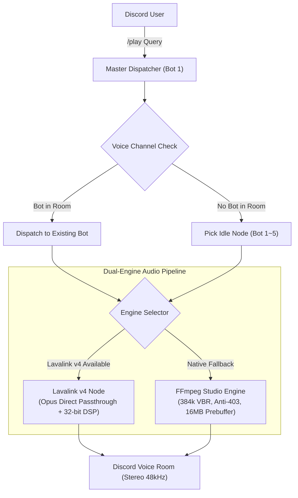

# DJ Donut — Discord Multi-Room Music Bot Cluster（多房間音樂機器人）

<div align="center">


**A Discord music bot cluster for managing multiple voice rooms.**  
**Run 1 to 5 bots in a single process, with independent playback in up to five voice rooms.**

[Invite Bots](#official-bots--實作機器人邀請) • [Features](#key-features--核心功能) • [Commands](#slash-commands-reference--斜線指令一覽) • [Quick Start](#quick-start--快速開始) • [Audio Settings](#audio-settings--音訊設定) • [Changelog](#release-notes--更新日誌) • [Feedback](#support--feedback--問題回饋與優化方案)

</div>

---

## Official Bots / 實作機器人邀請

可以直接將已架設的 **DJ Donut** 機器人矩陣邀請至你的 Discord 伺服器，立即體驗多房間獨立音樂播放：

| 機器人節點 | 邀請連結 (OAuth2 URL) | 權限設定 |
| :--- | :--- | :--- |
| DJ Donut 1  | [DJ Donut 1](https://discord.com/oauth2/authorize?client_id=1549028983641743462&permissions=8&integration_type=0&scope=bot) | 管理員權限 (`permissions=8`) |
| DJ Donut 2  | [DJ Donut 2](https://discord.com/oauth2/authorize?client_id=1549258600155979956&permissions=8&integration_type=0&scope=bot) | 管理員權限 (`permissions=8`) |
| DJ Donut 3  | [DJ Donut 3](https://discord.com/oauth2/authorize?client_id=1549259098761990184&permissions=8&integration_type=0&scope=bot) | 管理員權限 (`permissions=8`) |
| DJ Donut 4  | [DJ Donut 4](https://discord.com/oauth2/authorize?client_id=1549259563646062743&permissions=8&integration_type=0&scope=bot) | 管理員權限 (`permissions=8`) |
| DJ Donut 5  | [DJ Donut 5](https://discord.com/oauth2/authorize?client_id=1549259919696592976&permissions=8&integration_type=0&scope=bot) | 管理員權限 (`permissions=8`) |

> 💡 **多房間分流運作說明**：
> - 只要將多隻機器人邀請至同一伺服器，使用者在不同語音房輸入 `/play` 時，系統會**自動指派空閒的機器人進房**，實現多個房間同時獨立播放音樂！
> - 若伺服器內只有 1 隻機器人，當該機器人正在播放時，其他房間將無法使用，直到播放結束或邀請更多機器人進群。

---

## Key Features / 核心功能

- **Multi-room playback（多房間播放）**:
  - Run up to five Discord music bots in one Python process or Pterodactyl panel.
  - Use `/play <query>` to play music. The dispatcher checks the user’s voice channel and assigns an available bot when needed.
  - Each of the five rooms can have its own playback, queue, volume, and audio effects.

- **Dual-engine architecture（雙引擎架構）**:
  - **Engine A (Lavalink v4 + Wavelink)**: Supports Opus passthrough, JDA-NAS clock scheduling, and real-time 32-bit float DSP equalization.
  - **Engine B (FFmpeg)**: Runs without a separate Lavalink server. Includes an Opus transcoding pipeline, a 16 MB ring buffer, a one-thread CPU limit (`-threads 1`), and headers intended to help with YouTube 403 errors.

- **Localization（多國語言）**:
  - Supports **English (🇺🇸)**, **繁體中文 (🇹🇼)**, **简体中文 (🇨🇳)**, **日本語 (🇯🇵)**, **한국어 (🇰🇷)**, and **Español (🇪🇸)**.
  - Detects each user’s Discord client language through `interaction.locale`.
  - Server administrators can set the default language with `/language`.

- **Autoplay（自動接歌）**:
  - Run `/autoplay` to enable radio mode. When the queue ends, the bot looks for tracks with a similar style.

- **Lyrics（歌詞）**:
  - Run `/lyrics [song]` to look up synchronized or plain lyrics from LRCLIB and Netease Cloud. No API key is required for these lookups.

- **24/7 mode（常駐模式）**:
  - Run `/247` to keep the bot in a voice channel when listeners leave or playback is paused.

- **Multi-Platform Music Links（多平台音樂連結解析）**:
  - **Spotify**: 支援單曲、歌單與專輯連結解析，自動匹配高品質音源。
  - **網易雲音樂 (Netease Cloud Music)**: 支援單曲 (`song?id=`)、歌單 (`playlist?id=`)、專輯 (`album?id=`) 以及官方短網址 (`163cn.tv` / `163.lu`)，免 API Key 即時解析。
  - **Apple Music**: 支援單曲、專輯與官方公開歌單 (`music.apple.com` / `apple.co`)，自動提取高畫質封面與音軌清單。
  - **YouTube & SoundCloud**: 支援直接貼上影片、播放清單或關鍵字點歌。

- **Equalizer and bass boost（等化器與重低音）**:
  - Adjust bass boost with `/bassboost`, from +4 dB to +20 dB.
  - Use `/filter` to select sound presets, including Rock, Pop, Clear Vocal, Crisp Treble, Nightcore, Vaporwave, and 8D.

- **Modern UI & Interactive Controls（現代化視覺介面與全能控制器）**:
  - **Dynamic Scrubber Progress Bar**: 即時動態時間軸進度條（`01:23 ━━━━━━🔘─────── 04:29`），精確換算暫停與播放時長。
  - **Platform Badge & Color Accent**: 根據歌曲來源（Spotify, Netease, Apple Music, YouTube, SoundCloud）自動變更卡片主題色與標籤。
  - **10-Button Dual-Row Controller**: 提供播放/暫停、上一首重播、跳過、循環模式、停止退出、即時音量微調 (`🔉 -10%` / `🔊 +10%`)、電台接歌開關、一鍵歌詞視窗、以及即時隊列檢視。
  - **Cluster Status Dashboard**: 視覺化叢集負載條（`▰▰▰▱▱`）、各節點即時播放進度，以及未進群機器人的一鍵邀請鈕。

- **Resource usage（資源使用量）**:
  - The project targets roughly 70–120 MB of RAM for all five bots combined. Actual usage depends on the workload and environment.

---

## Slash Commands Reference / 斜線指令一覽

| Command (指令) | Parameters (參數) | Description (EN) | 說明 (繁體中文) |
| :--- | :--- | :--- | :--- |
| **/help** | *None* | Modern interactive manual with command categories | 查看現代化分類指令使用指南 |
| **/play** | `query`, `[bot_id]` | Smart play (Auto-dispatches idle bot or targeted bot 1~5) | 點歌（自動分配可用機器人，也可指定 1～5 號） |
| **/autoplay** | *None* | Toggle smart autoplay radio mode when queue ends | 切換自動接歌模式 (歌單結束自動接續播放) |
| **/lyrics** | `[song]` | View synced or plain lyrics for current / queried song | 查詢當前或指定歌曲的動態/純文字即時歌詞 |
| **/247** | *None* | Toggle 24/7 permanent stay-in-room mode | 切換 24/7 永久常駐語音房模式 |
| **/language** | `language` | Set server default language (en / zh-TW / ja / ko / es) | 設定伺服器預設語言 |
| **/status** | *None* | Live cluster dashboard for all 5 bot nodes | 查看各機器人的連線狀態、所在語音房與分流資訊 |
| **/nowplaying**| *None* | View track details, bitrate, engine & interactive controller | 查看目前歌曲、位元率及互動控制器 |
| **/queue** | *None* | View upcoming queued songs in your voice room | 查看你所在語音房的待播歌單隊列 |
| **/skip** | *None* | Skip currently playing song in your room | 跳過你當前語音房的歌曲 |
| **/stop** | `[force_all]` | Stop playback and leave voice room (or force-stop all bots) | 停止播放並退出語音房（或強制全部退出） |
| **/bassboost** | `level` | Adjust real-time Bass Boost (Off / Low / Medium / High / Extreme) | 調整重低音增強程度 |
| **/filter** | `preset` | Apply audio filters (Rock / Pop / Vocal / Nightcore / 8D / etc.) | 套用音效濾鏡 (搖滾/夜核/8D等) |
| **/bitrate** | `[kbps]` | Maximize voice channel bitrate up to 384kbps | 查看或調整目前語音房的位元率 |
| **/engine** | *None* | View Dual-Engine (Lavalink v4 / Native) real-time diagnostics | 查看雙引擎架構即時運作狀態與音訊規格 |

---

## Quick Start / 快速開始

### Option 1: Run with Python Locally (本機或 VPS 部署)

1. **Clone repository & install dependencies**:
   ```bash
   git clone https://github.com/asian0626/DJ-Donut.git
   cd DJ-Donut
   pip install -r requirements.txt
   ```
   *Make sure `ffmpeg` is installed on your system:*
   - Ubuntu / Debian: `sudo apt update && sudo apt install -y ffmpeg`
   - macOS: `brew install ffmpeg`
   - Windows: Download from [gyan.dev](https://www.gyan.dev/ffmpeg/builds/) and add to PATH.

2. **Configure Environment Variables**:
   Copy `.env.example` to `.env`:
   ```bash
   cp .env.example .env
   ```
   Edit `.env` and fill in your Discord Bot Token(s):
   ```env
   BOT_TOKEN_1=your_first_bot_token_here
   BOT_TOKEN_2=your_second_bot_token_here
   ...
   ```
   *(Configure as many tokens as you want from 1 to 5; the system automatically starts that many bots!)*

3. **Start the Bot Cluster**:
   ```bash
   python3 main.py
   ```

---

### Option 2: Run with Docker / Docker Compose (容器化部署)

1. **Configure `.env`**:
   ```bash
   cp .env.example .env
   # Edit .env with your bot tokens
   ```

2. **Start with Docker Compose**:
   ```bash
   docker compose up -d --build
   ```
   *Logs can be viewed with:*
   ```bash
   docker compose logs -f
   ```

---

### Option 3: Pterodactyl Panel (翼龍面板單一進程部署)

1. Download or git-clone this repository into your Pterodactyl server root folder.
2. Ensure your server image is **Python 3.10 / 3.11 / 3.12** with FFmpeg pre-installed.
3. Configure your tokens in `.env`.
4. Set the startup command to:
   ```bash
   python3 main.py
   ```
   *(or `python3 bot.py`)*
5. Click **Start**! All configured bots will log in simultaneously under that single panel process.

---

## Audio Settings / 音訊設定

If playback sounds muffled or the bass is weak, check these Discord settings:

### 1. Check Discord noise suppression
Discord’s noise suppression is designed for voice chat and may filter parts of music, such as drums, bass, or reverb.
- **Desktop (PC/Mac)**:
  1. Click **User Settings (Gear)** -> **Voice & Video**.
  2. Scroll to **Noise Suppression** -> Select **None** (Turn off Krisp).
  3. Turn off **Echo Cancellation** and **Advanced Voice Activity**.
- **Mobile (iOS/Android)**:
  Inside the voice room, swipe up and turn off **Noise Suppression**.

### 2. Adjust the channel bitrate (`/bitrate`)
Voice-channel bitrate depends on the server and channel settings. Run `/bitrate` if supported, or ask a server administrator to adjust the channel bitrate.

---

## Tech Stack & Architecture



- **Runtime**: Python 3.11+ asyncio event loop
- **Discord API**: `discord.py` 2.7+ with voice and application slash command tree
- **Audio Engines**: Lavalink v4 (Wavelink 3.4+) & FFmpeg Studio Transcoder
- **Extractor**: `yt-dlp` (Opus direct stream selector + Android/Web client bypass headers)
- **Lyrics Engine**: LRCLIB synchronized API + Netease fallback
- **i18n**: Built-in 6-language locale resolver (`en`, `zh-TW`, `zh-CN`, `ja`, `ko`, `es`)

---

## Release Notes / 更新日誌

### v1.0.5 (2026-10-15)
- 🚀 **徹底消除播放忽快忽慢與卡頓（加快/慢半拍）**：
  - **導入 5 秒動態音訊環形緩衝區 (`BufferedAudioSource`)**：以獨立背景執行緒預先解碼並快取 5 秒音訊（250 幀），解耦即時播放與網路拉流，徹底消除網路微延遲導致的 Discord WebRTC 自動快轉（加快）與掉拍卡頓（慢半拍）。
  - **重構 YouTube 串流客戶端與標頭**：改用穩定之 `tv` / `web` / `ios` 客戶端架構，移除引發嚴格限速（50KB/s）與中斷的 `android` 標籤，並注入完整瀏覽器請求標頭。
  - **優化 FFmpeg 串流握手參數**：啟用 `-http_persistent 0` 杜絕長連線閒置中斷，縮減斷線重連間隔至 2 秒，擴增分析時長（`analyzeduration 1000000` / `probesize 256k`）確保精準時鐘同步與取樣率對齊。

### v1.0.4 (2026-10-14)
- 🎨 **全新現代化播放介面**：導入高解析度動態時間軸進度條（Scrubber Bar）、多平台識別色彩（Spotify, Apple Music, 網易雲等）與沉浸式卡片排版。
- 🎛️ **雙排十鍵全能互動控制器**：升級為兩排 10 顆互動按鈕，支援免中斷音訊即時微調音量 (`-10%` / `+10%`)、一鍵查詢歌詞、隨選隊列、重播、單曲/歌單循環與電台接歌。
- 📊 **叢集儀表板與狀態視覺化**：重構 `/status` 導入叢集總負載指示條（`▰▰▰▱▱`）、即時播放進度、以及未加入伺服器節點的一鍵邀請連結。
- 📖 **新增現代化幫助指南 (`/help`)**：提供精美結構化分類指南，快速掌握所有播放、音效與管理指令。

### v1.0.3 (2026-10-14)
- 🎵 **新增網易雲音樂支援**：全面支援網易雲單曲、歌單、專輯及官方短網址（`163cn.tv` / `163.lu`）直貼播放，免額外 API Key 即時解析。
- 🍎 **新增 Apple Music 支援**：支援 Apple Music 單曲、專輯與公開精選歌單（`music.apple.com` / `apple.co`），自動擷取高畫質封面與音軌清單。
- ⚡ **統一多平台解析管線**：重構 Spotify、網易雲與 Apple Music 的解析調度管線，支援最大 200 首曲目整單極速入列與串流派發。

### v1.0.2 (2026-10-14)
- 🐛 **修復變數作用域異常**：解決 `/play` 指令中變數命名衝突引發的 `UnboundLocalError`，大幅提升點歌流程穩定度。
- ⚡ **Spotify 快取效能升級**：改用 `MemoryCacheHandler` 記憶體快取處理器，徹底消除無權限環境下的 `.cache` 磁碟寫入警告。
- 🤖 **實作機器人權限完善**：全數 1～5 號機器人節點邀請連結統一配置管理員權限 (`permissions=8`)。
- 🧹 **極簡純化架構**：徹底剔除內部冗餘註解與除錯資訊，減輕運算開銷並提升執行效率。
- 🌐 **國際化語系偵測**：支援 6 種語言智慧解析，各房間即時狀態面板新增版本號標註。

---

## Support & Feedback / 問題回饋與優化方案

若在使用過程中有任何問題、故障回報或效能優化方案，歡迎隨時聯絡：

- **電子郵件 (Email)**: [ian986260903@a1365.pro](mailto:ian986260903@a1365.pro)
- **GitHub Issues**: [提交 Issue / 功能建議](https://github.com/asian0626/DJ-Donut/issues)

---
