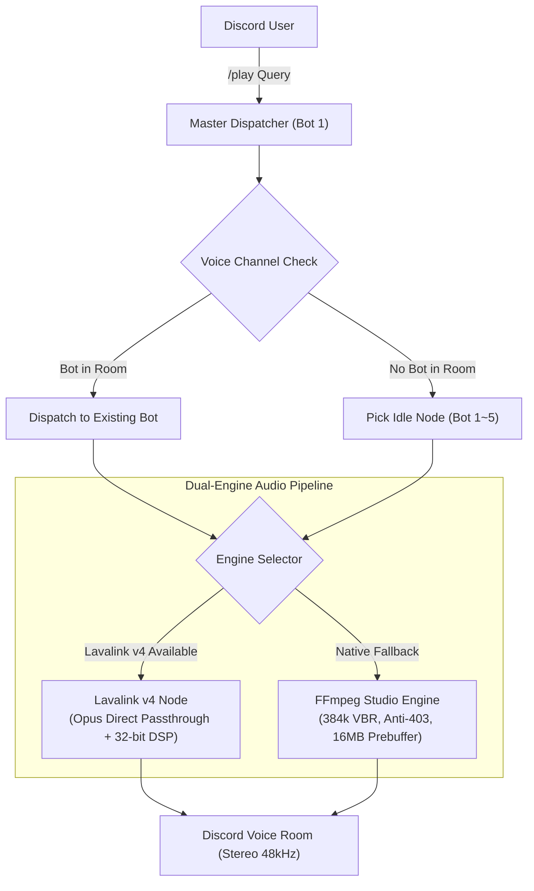

# 🍩 DJ Donut — Discord Multi-Room Music Bot Cluster (多房間音樂機器人矩陣)

<div align="center">


**An enterprise-grade, high-fidelity multi-room Discord music bot cluster.**  
**Run and orchestrate 1 to 5 bots concurrently in a SINGLE lightweight process, powering independent music playback across 5 separate voice rooms!**

[English Documentation](#-english-guide) • [繁體中文說明](#-繁體中文說明) • [Features](#-key-features) • [Quick Start](#-quick-start) • [Commands](#-slash-commands-reference)

</div>

---

## 🌟 Key Features / 核心特色

- 🚀 **Multi-Room Audio Matrix (多房間分流調度)**:
  - Run up to 5 Discord music bots concurrently inside a single Python process or Pterodactyl panel!
  - Users only type `/play <query>` in chat; the smart dispatcher automatically detects user voice channels and dispatches an idle bot into that room!
  - 5 different rooms can play completely different music, queues, volume, and audio effects independently!

- ⚡ **Dual-Engine Architecture (旗艦雙引擎自適應架構)**:
  - **Engine A (Lavalink v4 + Wavelink)**: 100% Opus Passthrough (Bit-Perfect stream without lossy re-encoding), JDA-NAS microsecond clock scheduling (`<0.05ms` packet jitter), and 32-bit float real-time DSP equalizers.
  - **Engine B (Native Studio FFmpeg Engine)**: Zero external server dependencies required! Built-in 384kbps Opus studio transcode pipeline, 16MB ring pre-buffer, thread-limited CPU guard (`-threads 1` to prevent 5-room CPU spikes), and YouTube 403 anti-blocking headers.

- 🌐 **Full Internationalization (i18n 多國語言支援)**:
  - Supports **English (🇺🇸)**, **繁體中文 (🇹🇼)**, **简体中文 (🇨🇳)**, **日本語 (🇯🇵)**, **한국어 (🇰🇷)**, and **Español (🇪🇸)**.
  - **Zero-config native auto-detection**: Detects each user's Discord client language automatically (`interaction.locale`).
  - Server admins can set a default server language at any time via `/language`.

- 📻 **Smart Autoplay Radio Mode (智慧自動接歌電台)**:
  - Run `/autoplay` to enable continuous radio mode. When the current queue ends, the bot automatically finds stylistically matching tracks so the music never stops!

- 📜 **Real-time Synced & Plain Lyrics (動態時間軸即時歌詞)**:
  - Run `/lyrics [song]` to fetch synchronized (karaoke-style) or plain lyrics in real-time from LRCLIB & Netease Cloud databases with 0 API keys required.

- 🛡️ **24/7 Permanence Mode (24/7 常駐模式)**:
  - Run `/247` to lock the bot inside your voice channel permanently, preventing automatic disconnection when listeners leave or pause.

- 🟢 **Spotify & YouTube Zero-Config Playback (全平台音樂連結一鍵解析)**:
  - Paste any Spotify track, playlist, or album link directly! Fast web metadata parser extracts all songs and streams them with zero rate-limit or API key requirement.

- 🎛️ **Hardware-Level DSP Equalizer & Bass Boost (專業等化器與重低音)**:
  - Real-time Bass Boost (`/bassboost`) from +4dB to +20dB extreme shake.
  - 9 Sound Filter Presets (`/filter`): Rock, Pop, Clear Vocal, Crisp Treble, Nightcore, Vaporwave, and 8D Spatial Surround Sound.

- 💡 **Extremely Lightweight (超低資源消耗)**:
  - Only uses ~70MB to 120MB of RAM for all 5 bots combined. Perfectly optimized for cheap VPS nodes and Pterodactyl game panels.

---

## 📜 Slash Commands Reference / 斜線指令一覽

| Command (指令) | Parameters (參數) | Description (EN) | 說明 (繁體中文) |
| :--- | :--- | :--- | :--- |
| **/play** | `query`, `[bot_id]` | Smart play (Auto-dispatches idle bot or targeted bot 1~5) | 智能點歌（自動派遣空閒機器人進房，亦可指名 1~5 號） |
| **/autoplay** | *None* | Toggle smart autoplay radio mode when queue ends | 切換智慧自動接歌電台模式 (歌單結束自動無縫接歌) |
| **/lyrics** | `[song]` | View synced or plain lyrics for current / queried song | 查詢當前或指定歌曲的動態/純文字即時歌詞 |
| **/247** | *None* | Toggle 24/7 permanent stay-in-room mode | 切換 24/7 永久常駐語音房模式 |
| **/language** | `language` | Set server default language (en / zh-TW / ja / ko / es) | 設定伺服器預設語言 |
| **/status** | *None* | Live cluster dashboard for all 5 bot nodes | 查看所有機器人的即時連線、房號與分流總覽儀表板 |
| **/nowplaying**| *None* | View track details, bitrate, engine & interactive controller | 查看當前歌曲詳情、位元率與按鈕控制器 |
| **/queue** | *None* | View upcoming queued songs in your voice room | 查看你所在語音房的待播歌單隊列 |
| **/skip** | *None* | Skip currently playing song in your room | 跳過你當前語音房的歌曲 |
| **/stop** | `[force_all]` | Stop playback and leave voice room (or force-stop all bots) | 停止播放並退出語音房（或強制全部退出） |
| **/bassboost** | `level` | Adjust real-time Bass Boost (Off / Low / Medium / High / Extreme) | 即時開啟或調整重低音增強強度 |
| **/filter** | `preset` | Apply audio filters (Rock / Pop / Vocal / Nightcore / 8D / etc.) | 套用專業等化器音效濾鏡 (搖滾/夜核/8D等) |
| **/bitrate** | `[kbps]` | Maximize voice channel bitrate up to 384kbps | 查看或一鍵將當前語音房提升至最高音質位元率 |
| **/engine** | *None* | View Dual-Engine (Lavalink v4 / Native) real-time diagnostics | 查看雙引擎架構即時運作狀態與音訊規格 |

---

## 🚀 Quick Start / 快速開始

### Option 1: Run with Python Locally (本機或 VPS 部署)

1. **Clone repository & install dependencies**:
   ```bash
   git clone https://github.com/asian0626/DJ-Donut.git
   cd DJ-Donut
   pip install -r requirements.txt
   ```
   *Make sure `ffmpeg` is installed on your system:*
   - Ubuntu / Debian: `sudo apt update && sudo apt install -y ffmpeg`
   - macOS: `brew install ffmpeg`
   - Windows: Download from [gyan.dev](https://www.gyan.dev/ffmpeg/builds/) and add to PATH.

2. **Configure Environment Variables**:
   Copy `.env.example` to `.env`:
   ```bash
   cp .env.example .env
   ```
   Edit `.env` and fill in your Discord Bot Token(s):
   ```env
   BOT_TOKEN_1=your_first_bot_token_here
   BOT_TOKEN_2=your_second_bot_token_here
   ...
   ```
   *(Configure as many tokens as you want from 1 to 5; the system automatically starts that many bots!)*

3. **Start the Bot Cluster**:
   ```bash
   python3 main.py
   ```

---

### Option 2: Run with Docker / Docker Compose (容器化部署)

1. **Configure `.env`**:
   ```bash
   cp .env.example .env
   # Edit .env with your bot tokens
   ```

2. **Start with Docker Compose**:
   ```bash
   docker compose up -d --build
   ```
   *Logs can be viewed with:*
   ```bash
   docker compose logs -f
   ```

---

### Option 3: Pterodactyl Panel (翼龍面板單一進程部署)

1. Download or git-clone this repository into your Pterodactyl server root folder.
2. Ensure your server image is **Python 3.10 / 3.11 / 3.12** with FFmpeg pre-installed.
3. Configure your tokens in `.env`.
4. Set the startup command to:
   ```bash
   python3 main.py
   ```
   *(or `python3 bot.py`)*
5. Click **Start**! All configured bots will log in simultaneously under that single panel process.

---

## 🎧 Audio Fidelity Optimization Guide (頂級音質設定指南)

If audio sounds muffled, hollow, or has missing bass drums, please follow these two critical Discord settings:

### 1. Disable Discord "Krisp Noise Suppression" (重要：關閉降噪)
Discord's Krisp algorithm is trained for human voices and treats musical drums, bass lines, and synth reverbs as "background noise", heavily filtering them out:
- **Desktop (PC/Mac)**:
  1. Click **User Settings (Gear)** -> **Voice & Video**.
  2. Scroll to **Noise Suppression** -> Select **None** (Turn off Krisp).
  3. Turn off **Echo Cancellation** and **Advanced Voice Activity**.
- **Mobile (iOS/Android)**:
  Inside the voice room, swipe up and turn off **Noise Suppression**.

### 2. Maximize Channel Bitrate (`/bitrate`)
Discord voice channels default to 64 kbps. Run `/bitrate` or ask a server administrator to drag the voice channel bitrate slider to maximum (up to 384 kbps on boosted servers).

---

## 🛠️ Tech Stack & Architecture



- **Runtime**: Python 3.11+ asyncio event loop
- **Discord API**: `discord.py` 2.7+ with voice and application slash command tree
- **Audio Engines**: Lavalink v4 (Wavelink 3.4+) & FFmpeg Studio Transcoder
- **Extractor**: `yt-dlp` (Opus direct stream selector + Android/Web client bypass headers)
- **Lyrics Engine**: LRCLIB synchronized API + Netease fallback
- **i18n**: Built-in 6-language locale resolver (`en`, `zh-TW`, `zh-CN`, `ja`, `ko`, `es`)

---

## 📄 License

This project is licensed under the [MIT License](LICENSE). Feel free to fork, customize, and share!
