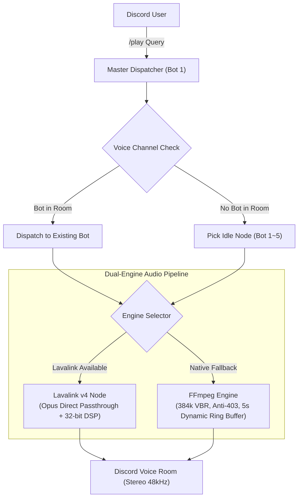

# DJ Donut — Discord Multi-Room Music Bot

<div align="center">


**A lightweight, multi-room Discord music bot cluster.**  
Run 1 to 5 bot instances inside a single Python process to stream music into multiple voice channels simultaneously, each with independent queues and audio controls.

[Bot Invitations](#bot-invitations) • [Features](#features) • [Slash Commands](#slash-commands) • [Quick Start](#quick-start) • [Audio Tips](#audio-troubleshooting) • [Changelog](#changelog) • [Feedback](#support--feedback)

</div>

---

## Bot Invitations

You can invite the pre-hosted **DJ Donut** cluster directly to your server:

| Bot Node | Invite Link | Default Permissions |
| :--- | :--- | :--- |
| **DJ Donut 1** | [Invite Bot 1](https://discord.com/oauth2/authorize?client_id=1549028983641743462&permissions=8&integration_type=0&scope=bot) | Administrator  |
| **DJ Donut 2** | [Invite Bot 2](https://discord.com/oauth2/authorize?client_id=1549258600155979956&permissions=8&integration_type=0&scope=bot) | Administrator  |
| **DJ Donut 3** | [Invite Bot 3](https://discord.com/oauth2/authorize?client_id=1549259098761990184&permissions=8&integration_type=0&scope=bot) | Administrator  |
| **DJ Donut 4** | [Invite Bot 4](https://discord.com/oauth2/authorize?client_id=1549259563646062743&permissions=8&integration_type=0&scope=bot) | Administrator  |
| **DJ Donut 5** | [Invite Bot 5](https://discord.com/oauth2/authorize?client_id=1549259919696592976&permissions=8&integration_type=0&scope=bot) | Administrator  |

> 💡 **How Multi-Room Dispatch Works**:
> When someone runs `/play` in any voice room, the dispatcher checks who is already in that channel. If none of the bots are in that room yet, it automatically grabs an idle bot and joins. If all 5 bots are invited to your server, up to 5 voice rooms can listen to completely different music at the same time.

---

## Features

- **Multi-Room Clustering**: Run up to 5 bots under a single process or game panel. Each voice room gets its own independent queue, volume, loop setting, audio filters, and progress tracker.
- **Dual-Engine Audio Pipeline**:
  - **Lavalink v4**: Connects to an external Lavalink node for high-throughput Opus passthrough and real-time DSP equalizers.
  - **Native FFmpeg Engine**: Runs natively without extra server software. Includes a dynamic ring buffer (`BufferedAudioSource`), custom stream headers to bypass YouTube 403 errors, and CPU thread capping (`-threads 1`).
- **Multi-Platform Support**: Paste links directly from YouTube, SoundCloud, Spotify (tracks, albums, playlists), Apple Music, and NetEase Cloud Music (including `163cn.tv` shortlinks).
- **Smooth Audio Streaming**: Decouples audio decoding from Discord voice transmission using a 5-second ring buffer to prevent playback jitter, sudden fast-forwarding, or audio dropouts.
- **Full Queue & Playback Control**: Jump to specific timestamps with `/seek`, randomize the queue with `/shuffle`, drop unwanted tracks with `/remove`, or wipe the list with `/clear`.
- **Interactive Controller UI**: Real-time progress bar (`01:23 ━━━━━━🔘─────── 04:29`), platform-themed embed cards, and a 10-button controller for volume adjustments, seeking, looping, and lyrics.
- **Synchronized Lyrics**: Fetch synchronized or plain-text lyrics on the fly via LRCLIB and NetEase without needing third-party API keys.
- **Server Settings Persistence**: Volume levels, language preferences, 24/7 mode, bass boost, and audio filters are saved per-server in `guild_settings.json` and persist across bot reboots.
- **Smart Autoplay**: Enable `/autoplay` to keep the music playing with stylistic recommendations once the queue finishes.
- **Multilingual Support**: Supports English, Traditional Chinese, Simplified Chinese, Japanese, Korean, and Spanish. Automatically detects each user's client locale.
- **Lightweight Footprint**: Typically runs within 80–120 MB RAM even with all 5 nodes active.

---

## Slash Commands

| Command | Arguments | Description |
| :--- | :--- | :--- |
| **/help** | *None* | Interactive manual categorized by features |
| **/play** | `query`, `[bot_id]` | Play a track or playlist (auto-dispatches an idle bot or targeted bot 1–5) |
| **/search** | `query` | Search tracks and pick from an interactive top-5 select menu |
| **/pause** | *None* | Pause the currently playing track in your voice room |
| **/resume** | *None* | Resume paused playback with automatic stream re-anchoring |
| **/seek** | `time` | Fast-forward or jump to a timestamp (e.g. `90` or `01:30`) |
| **/move** | `from`, `to` | Move a queued track to a new position |
| **/replay** | `[index]` | Replay a track from playback history |
| **/shuffle** | *None* | Randomly shuffle all upcoming songs in the queue |
| **/remove** | `index` | Remove a specific track from the queue by its number |
| **/clear** | *None* | Clear all upcoming songs from the queue |
| **/history** | *None* | View the last 15 songs played in this room |
| **/favorite** | `action`, `[index]` | Manage personal favorite tracks (`play`, `list`, `add`, `remove`, `clear`) |
| **/nowplaying**| *None* | Show track details, synced karaoke lyrics, progress bar, and controller |
| **/queue** | *None* | Browse the upcoming track queue with interactive pagination |
| **/skip** | *None* | Skip the track currently playing in your room (DJ guarded) |
| **/stop** | `[force_all]` | Stop playback and disconnect the bot (or stop all bots) |
| **/dj** | `[role]`, `[clear]` | Manage or view server DJ permission role |
| **/autoplay** | *None* | Toggle smart autoplay radio mode when queue ends |
| **/lyrics** | `[song]` | Look up synced or plain lyrics for current or queried track |
| **/bassboost** | `level` | Live-adjust bass boost (`+4dB` to `+20dB`) with instant stream hot-swap |
| **/filter** | `preset` | Live-apply audio filters (Rock, Pop, Vocal, Nightcore, 8D, etc.) |
| **/bitrate** | `[kbps]` | Maximize the voice channel bitrate up to 384kbps |
| **/status** | *None* | Live cluster dashboard for all 5 bot nodes |
| **/247** | *None* | Toggle 24/7 permanent room presence |
| **/language** | `language` | Set server default language (`en` / `zh-TW` / `zh-CN` / `ja` / `ko` / `es`) |
| **/engine** | *None* | View real-time audio pipeline and engine diagnostics |

---

## Quick Start

### 1. Run with Python (Local or VPS)

1. **Clone the repository and install dependencies**:
   ```bash
   git clone https://github.com/asian0626/DJ-Donut.git
   cd DJ-Donut
   pip install -r requirements.txt
   ```
   *Make sure `ffmpeg` is installed on your system:*
   - **Ubuntu / Debian**: `sudo apt update && sudo apt install -y ffmpeg`
   - **macOS**: `brew install ffmpeg`
   - **Windows**: Download from [gyan.dev](https://www.gyan.dev/ffmpeg/builds/) and add to your PATH.

2. **Configure your tokens**:
   ```bash
   cp .env.example .env
   ```
   Open `.env` and fill in your Discord Bot token(s):
   ```env
   BOT_TOKEN_1=your_first_bot_token_here
   BOT_TOKEN_2=your_second_bot_token_here
   # Add up to BOT_TOKEN_5 if you want all 5 nodes
   ```

3. **Start the cluster**:
   ```bash
   python3 main.py
   ```

---

### 2. Run with Docker Compose

1. Set up your `.env`:
   ```bash
   cp .env.example .env
   # Add your BOT_TOKEN_1 ~ BOT_TOKEN_5
   ```

2. Launch the container:
   ```bash
   docker compose up -d --build
   ```

3. Check logs:
   ```bash
   docker compose logs -f
   ```

---

### 3. Pterodactyl Game Panel

1. Upload or git-clone the repo directly into your Pterodactyl server root folder.
2. Ensure your egg is using a **Python 3.10, 3.11, or 3.12** image with FFmpeg installed.
3. Add your tokens to `.env`.
4. Set the startup command to:
   ```bash
   python3 main.py
   ```
5. Click **Start**. All configured bot tokens will log in together within that single panel container.

---

## Audio Troubleshooting

If audio sounds muffled, muddy, or quiet, it is almost always due to Discord's built-in noise suppression filtering out music frequencies.

### 1. Disable Krisp Noise Suppression
Discord's noise gate is tuned for human speech and treats heavy bass, synth, or drums as background noise.
- **Desktop (PC / Mac)**:
  1. Open **User Settings** (gear icon) -> **Voice & Video**.
  2. Under **Noise Suppression**, select **None** (turn off Krisp).
  3. Turn off **Echo Cancellation** if music still cuts in and out.
- **Mobile (iOS / Android)**:
  Swipe up while connected to the voice room and toggle off **Noise Suppression**.

### 2. Maximize Room Bitrate (`/bitrate`)
Discord defaults new voice channels to 64 kbps. Run `/bitrate` while in your voice room to immediately raise the channel to your server's maximum allowable rate (up to 384 kbps for boosted servers).

---

## Architecture



- **Runtime**: Python 3.11+ asyncio
- **Discord Library**: `discord.py` 2.7+ with application slash command tree
- **Audio Engines**: Lavalink v4 (Wavelink 3.4+) & Native FFmpeg Transcoder
- **Extractor**: `yt-dlp` with thread-local caching and adaptive user-agents
- **Lyrics Engine**: LRCLIB (synced) & NetEase (plain fallback)
- **i18n**: Built-in 6-language locale detection (`en`, `zh-TW`, `zh-CN`, `ja`, `ko`, `es`)

### Modular Project Layout

```
discord-music-bot/
├── main.py              # Lightweight cluster entrypoint & matrix initializer
├── bot.py               # Alternative entrypoint script
├── config.py            # Global settings, presets, logger & BotError hierarchy
├── core/
│   ├── models.py        # Song, GuildMusicState & BufferedAudioSource
│   ├── player.py        # Audio pipeline playback engine & play_next loop
│   ├── dispatcher.py    # Voice channel matching & smart multi-bot routing
│   └── node.py          # MusicNodeBot client definition & cluster lifecycle
├── platforms/
│   ├── youtube.py       # Stream URL extraction & smart autoplay finder
│   ├── spotify.py       # Spotify web scraping, oEmbed & API track resolver
│   ├── netease.py       # NetEase song, album & playlist resolver
│   └── apple_music.py   # Apple Music metadata and album art scraper
├── ui/
│   ├── embeds.py        # Embed cards, progress bar & duration formatters
│   └── views.py         # Dynamic 10-button music controller & select menus
├── commands/
│   ├── music.py         # /play, /search, /skip, /stop, /queue, /move
│   ├── audio.py         # /seek, /bassboost, /filter, /bitrate, /engine
│   └── admin.py         # /status, /help, /dj, /shuffle, /lyrics, /language
├── i18n.py              # Multi-language translations
└── lyrics.py            # Synced and plain lyrics provider
```

---

## Changelog

### v1.6.0 (2026-10-23)
- **Zero-Gap Next-Track Background Pre-Resolution**: Automatically resolves and caches the upcoming track's stream URL (`state.queue[0]`) in the background 3 seconds after playback begins, reducing track transition latency to `<1ms`.
- **Live Real-Time DSP Filter & Bassboost Hot-Swapping**: Upgraded `/bassboost` and `/filter` on the Native FFmpeg Engine to hot-swap the active audio stream right at the current playback second (`hot_swap_current_stream`), letting listeners hear EQ, Nightcore, Vaporwave, and 8D Surround changes in under 1 second without waiting for the next track.
- **Voice WebSocket 1006 Auto-Reconnect & Mid-Song Resume**: Added automatic voice channel reconnection and exact-second playback re-anchoring if a track is unexpectedly interrupted mid-song by Discord voice gateway resets (`code 1006`) or CDN socket drops.
- **Live Synced Karaoke Lyrics & Async `aiohttp` Lyrics Engine**: Rebuilt `lyrics.py` with non-blocking `aiohttp` pooling and a 1-hour LRU cache (`_LYRICS_CACHE`). Parsed LRC `[mm:ss.xx]` timestamps to display live scrolling Karaoke lyrics directly inside the Now Playing card and highlight the active line in `/lyrics`.
- **Anti-Spam Now Playing Card Cleanup**: Automatically deletes the previous track's Now Playing controller message before posting the new card, keeping text channels completely clean during long listening sessions.
- **Interactive Paginated Queue Browser**: Added `QueuePaginationView` (`⏮️`, `⬅️`, `➡️`, `⏭️`, `🔀`) to `/queue` and the controller's Queue button, allowing seamless browsing across hundreds of queued tracks.
- **Personal Favorites Playlist System (`/favorite` & Controller Buttons)**: Added `/favorite` (`play`, `list`, `add`, `remove`, `clear`) and 3 new quick-action controller buttons (`❤️ Favorite`, `⭐ Play Favorites`, `🔀 Shuffle`) with atomic persistence.

### v1.5.5 (2026-10-20)
- **Eliminate FFmpeg Pipe Reader Write Error**: Removed invalid `stderr=subprocess.DEVNULL` parameter in `FFmpegPCMAudio` across `core/player.py`, `core/models.py`, and `commands/audio.py`. In discord.py, passing an integer to `stderr` causes the internal `_pipe_reader` thread to attempt `dest.write(data)` on an `int`, crashing with `AttributeError: 'int' object has no attribute 'write'`. FFmpeg output is already cleanly suppressed via `-nostats -loglevel fatal`.
- **Bulletproof Voice Disconnect & Reconnect Handling**: Hardened `safe_disconnect` against `AttributeError: 'NoneType' object has no attribute '_get_voice_client_key'` when `vc.channel` is already `None` following Discord voice WebSocket drops (`code 1006`), ensuring internal discord.py voice client tracking maps (`_connection._voice_clients`) are reliably pruned without raising unhandled exceptions.
- **Accurate Voice Connection Validation**: Added explicit `vc.channel is None` check to `is_vc_connected` to immediately identify severed voice sessions before attempting move or play operations.

### v1.5.4 (2026-10-20)
- **Multi-Node Voice Cross-Talk Elimination**: Fixed interactive controller buttons (`play/pause`, `skip`, `stop`, `replay`, `volume`) routing commands to incorrect nodes by dynamically resolving voice clients from the targeted node bot rather than the default guild client.
- **Zero-Latency Audio Clock (Non-Blocking Buffer)**: Completely eradicated micro-stutters and Discord audio thread stalls by converting `BufferedAudioSource.read()` to non-blocking `get_nowait()`, reliably serving silent Opus packets on buffer underflows without blocking the critical 20ms timing loop.
- **Thread Pool Scaling & API Isolation**: Scaled `MEDIA_EXECUTOR` to 25 parallel workers and introduced a dedicated `API_EXECUTOR` for platform metadata resolution (Spotify, Apple Music, NetEase), preventing HTTP latency from choking FFmpeg and yt-dlp audio decoding tasks.
- **Atomic Guild Settings Persistence**: Replaced direct file writes with an atomic temp-file replace pattern (`tempfile` + `os.replace`) backed by an in-memory cache, eliminating settings file corruption during concurrent guild writes.
- **Autonomous Empty Room Detection & 24/7 Guard**: Implemented robust empty-room auto-leave with a 60-second grace period and join cancellation, while honoring 24/7 persistent mode and cleaning up guild state on bot eviction (`on_guild_remove`).
- **Dynamic Multi-Bot Invite Generator**: Upgraded `/status` cluster dashboard to dynamically compute OAuth2 invite URLs directly from live client IDs, ensuring self-hosters and custom deployments get accurate invite links for all node bots.
- **Autocomplete Throttling & Suggestion Cache**: Added a 120-second TTL LRU cache for Google Suggest queries in `/play` and `/search` autocomplete, dramatically slashing redundant API roundtrips during rapid user keystrokes.
- **Security & Docker Hardening**: Added `.dockerignore` to secure sensitive `.env` credentials, migrated Docker container execution to an unprivileged non-root user (`botuser`), restricted Lavalink exposure to local loopback (`127.0.0.1`), and enabled persistent settings volume mounting.
- **Audio DSP & Preset Fixes**: Corrected `/filter` bass boost preset mapping and pre-loaded guild language configurations on bot startup.

### v1.5.3 (2026-10-18)
- **Admin Kick & Voice Disconnect Recovery**: Fully handled voice disconnect events (`VOICE_STATE_UPDATE` where `after.channel is None`) by cleanly disconnecting and deregistering the `VoiceClient` from discord.py's internal connection state, completely preventing `ClientException: Already connected to a voice channel for this guild` on subsequent `/play` commands.
- **Cute Departure Notification**: Sent a sweet pastel-pink embed with kaomoji (`(｡•́︿•̀｡)` & `(๑•́ ₃ •̀๑)`) to the room's text channel if the bot is kicked or disconnected by an administrator, notifying users that the bot can be summoned back immediately with `/play`.
- **Extended Pause Recovery & Re-Anchoring**: Fixed audio freezing and playback failure after extended pause periods by flushing stale cached stream URLs, fetching fresh YouTube CDN streams, and safely awaiting `AudioPlayer` termination before re-anchoring playback with FFmpeg.
- **Auto Voice Reconnect on Resume**: Added automatic voice channel reconnection if the voice socket dropped or timed out during a prolonged pause, ensuring seamless resumption right from where playback stopped.

### v1.5.2 (2026-10-17)
- **Infinite Controller Lifespan**: Updated `MusicControllerView` to `timeout=None` and removed automatic button disabling so the interactive Now Playing panel remains permanently responsive regardless of pause duration.
- **Smart Stale TCP Re-Anchoring**: Validated stream URLs on resume after pauses `>= 15s` and re-anchored playback at the exact elapsed second to recover from remote CDN socket timeouts.
- **Dynamic Play/Pause Toggle**: Updated the interactive controller button to dynamically switch between `▶️` (play/resume) and `⏸️` (pause) based on live playback state.
- **Added `/pause` and `/resume` Commands**: Added dedicated slash commands with DJ permission enforcement, voice room routing, and multi-bot cluster support.

### v1.5.1 (2026-10-17)
- **Extractor Client Update**: Configured `yt-dlp` to use mobile player clients (`['android', 'ios']`), bypassing web BotGuard and GVS PO Token restrictions in Docker and cloud environments without cookies.
- **Enabled HLS Streams**: Removed `skip: ['hls']` to allow FFmpeg to ingest HLS audio streams seamlessly.
- **Robust URL Resolution**: Validated 11-character YouTube video IDs in `Song.__init__` and playlist parsing before prepending watch URLs.
- **Smart Multilingual Title Fallback**: Stripped full-width CJK brackets (`【】`, `「」`, `『』`) and promotional noise during fallback searches before falling back to SoundCloud.
- **Format Filtering**: Excluded storyboard image mosaics (`sb0`–`sb3`) from audio format candidate selection.

### v1.5.0 (2026-10-16)
- **Non-Recursive Playback Loop & Exponential Backoff**: Completely rewrote `play_next` to use an iterative loop that eliminates recursion limits during stream resolution failures; added exponential backoff retries (0.5s, 1.2s, 2.5s) on stream extraction to survive transient network spikes.
- **Smart Stream Expiration & Cache Invalidation**: Automatically parses `expire` timestamps on Google Video stream URLs to avoid serving stale links, and actively flushes cache entries on FFmpeg playback errors.
- **Memory & Resource Leak Elimination**: Added an explicit `__del__` destructor to `BufferedAudioSource` to guarantee background reader threads and FFmpeg processes terminate promptly; upgraded idle room state cleanup to fully cancel active progress tasks and release player views.
- **Live Dynamic Progress Scrubber**: Added a background task that smoothly updates the Now Playing progress bar embed every 15 seconds while playing, maintaining accurate elapsed times without exceeding Discord rate limits.
- **Real-Time YouTube Query Autocomplete**: Integrated instant YouTube search suggestions into `/play` and `/search` via non-blocking queries, delivering live autocomplete options as users type.
- **Comprehensive 6-Language Localization**: Expanded `i18n.py` to cover all administrative, queue manipulation, seek, and DJ permission interactions across English, Traditional Chinese, Simplified Chinese, Japanese, Korean, and Spanish.
- **Smart Autoplay Loop Prevention**: Enhanced the radio recommendation engine to filter out recently played tracks, preventing repetitive recommendation cycles.

### v1.4.0 (2026-10-15)
- **Asynchronous Network Pipeline**: Switched track metadata fetching across Spotify, NetEase Cloud Music, and Apple Music from blocking urllib requests to non-blocking `aiohttp` with connection pooling, keeping the audio worker threads free for stream extraction.
- **Instant Metadata Caching**: Added an in-memory metadata cache (1-hour TTL) for all resolved platform tracks and playlists, reducing repeat query times to sub-millisecond speeds.
- **Fast Spotify oEmbed Resolution**: Optimized track lookups by hitting the lightweight official oEmbed endpoint (~150ms) before scraping full web embed HTML, significantly accelerating single-track playback.
- **Thread-Safe Extractor Reuse**: Replaced ad-hoc `yt_dlp.YoutubeDL()` constructions with reusable thread-local extractors across all platform resolvers to prevent extractor initialization overhead.
- **Dual-Key Stream Caching**: Stream URLs are now indexed by both track URL and song title, guaranteeing immediate cache hits across cross-platform searches and replay requests.
- **Clean Shutdown Hook**: Automatically tears down connection pools and background HTTP sessions on bot shutdown.

### v1.3.1 (2026-10-15)
- **Resolved `/play` NoneType Error**: Fixed `AttributeError: 'NoneType' object has no attribute 'get'` triggered when search queries returned restricted, deleted, or empty entries under yt-dlp `ignoreerrors=True`.
- **Defensive Track Metadata Validation**: Hardened `Song` data constructor to gracefully handle `None` and non-dict inputs, ensuring fallback values are always populated safely.
- **Robust Preset Lookups**: Protected DSP equalizer presets and bass boost configurations with default dictionaries against missing or malformed keys.

### v1.3.0 (2026-10-15)
- **Modular Architecture Decomposition**: Broke down the 3,500+ line monolithic `main.py` into decoupled, maintainable packages (`core/`, `platforms/`, `ui/`, `commands/`, `config.py`).
- **Centralized Settings & Presets**: Extracted all audio filter parameters, bass boost curves, ffmpeg/yt-dlp options, and guild persistence helpers into `config.py`.
- **Standardized Error Hierarchy**: Introduced custom `BotError` base and specialized exceptions (`AudioSourceError`, `TrackNotFoundError`, `VoiceConnectionError`, `PermissionDeniedError`) for cleaner debugging.
- **Structured Logging**: Replaced scattered print statements with a unified `logging` logger across all subsystems.
- **Full Compatibility Preserved**: Seamless entrypoint support for both `python3 main.py` and `python3 bot.py`, zero circular imports, and zero docstrings/comments.

### v1.2.0 (2026-10-15)
- **Interactive Search Menu**: Added `/search <query>` allowing users to search YouTube and pick tracks from an interactive Discord UI drop-down menu showing title, duration, and artist.
- **Queue Reordering**: Added `/move <from> <to>` to freely reposition songs inside the upcoming queue without restarting playback.
- **History Replay**: Added `/replay [index]` to quickly re-queue songs directly from room history.
- **DJ Permission Roles**: Added `/dj [role] [clear]` to configure dedicated DJ roles. When set, only DJs and server administrators can skip, stop, or clear the queue in shared rooms.
- **Smart Query Autocomplete**: Added autocomplete suggestions to `/play` with listening history matches and popular genre queries.
- **Memory & Resource Reclamation**: Implemented a 10-minute periodic task to automatically garbage-collect idle room states (> 30 mins) and added a 5-minute timeout to player views.
- **Playlist Stream Stability**: Resolved audio thread deadlocks and aligned User-Agent headers across yt-dlp and FFmpeg to prevent runaway skipping on long playlists.

### v1.1.0 (2026-10-15)
- **Dedicated Media Worker Pool**: Offloaded Spotify, NetEase, Apple Music, and yt-dlp metadata extraction to a 10-worker `ThreadPoolExecutor`, preventing the main asyncio event loop from stalling during heavy track resolution.
- **Extractor Caching**: Added thread-local `YoutubeDL` instances (`threading.local`) and a 30-minute in-memory stream URL cache to cut query resolution times and reduce memory allocations.
- **Queue Controls**: Added `/seek` (timestamp seeking in seconds or `mm:ss`), `/shuffle` (randomize current queue), `/remove` (delete track by index), `/clear` (wipe upcoming queue), and `/history` (view recently played tracks).
- **Auto-Recovery & Failure Breaker**: Added exponential backoff retries on broken stream connections, and an automatic circuit-breaker that pauses playback after 5 consecutive resolution failures to prevent infinite skip loops.
- **Settings Persistence**: Guild settings (default volume, language, 24/7 permanence, bass boost level, and audio filter) now save to `guild_settings.json` and persist across bot restarts.
- **Cleaner Shutdowns**: Implemented `__del__` cleanup on `BufferedAudioSource` to guarantee background reader threads and audio buffers terminate promptly when skipping or stopping tracks.

### v1.0.5 (2026-10-15)
- **Eliminated Audio Stutter & Speed Jumps**:
  - Implemented `BufferedAudioSource`, a 5-second dynamic ring buffer running on a separate worker thread to decouple network fetching from real-time Discord voice playback.
  - Replaced unstable YouTube clients with reliable `tv` and `web` player profiles, avoiding aggressive 50KB/s download throttling and sudden stream resets.
  - Tweaked FFmpeg stream options: set `-http_persistent 0` to avoid dead connections and extended probe durations (`analyzeduration 1000000`, `probesize 256k`) to prevent clock drift.

### v1.0.4 (2026-10-14)
- **Modernized Player Interface**: Added a dynamic scrubber bar (`01:23 ━━━━━━🔘─────── 04:29`), platform-themed color accents, and cleaner embed formatting.
- **10-Button Dual-Row Controller**: Replaced basic buttons with a compact dual-row controller supporting live volume adjustments (`-10%` / `+10%`), instant lyrics, queue views, replay, and loop mode toggling.
- **Cluster Status Dashboard**: Added `/status` dashboard showing active rooms, per-node playback info, and direct OAuth2 invite links for any offline or missing bots.
- **Interactive Help Menu**: Added `/help` command categorizing all playback, audio, and queue controls.

### v1.0.3 (2026-10-14)
- **NetEase Cloud Music Support**: Added direct support for NetEase songs, playlists, albums, and short URLs (`163cn.tv` / `163.lu`).
- **Apple Music Support**: Added metadata resolution for Apple Music song, playlist, and album links (`music.apple.com` / `apple.co`).
- **Batch Resolution**: Streamlined track importing for third-party playlists, queuing up to 200 songs smoothly.

### v1.0.2 (2026-10-14)
- **Fixed Variable Scope Bug**: Resolved an `UnboundLocalError` in `/play` caused by shadowed variable names.
- **In-Memory Spotify Token Cache**: Switched to `MemoryCacheHandler` to prevent file permission errors on read-only hosting environments.
- **Permission Cleanup**: Updated OAuth2 invite links to request administrator permissions (`permissions=8`) to prevent channel permission issues.

---

## Support & Feedback

If you encounter any bugs, playback issues, or have suggestions:

- **Email**: [ian986260903@a1365.pro](mailto:ian986260903@a1365.pro)
- **GitHub Issues**: [Open an Issue / Feature Request](https://github.com/asian0626/DJ-Donut/issues)
