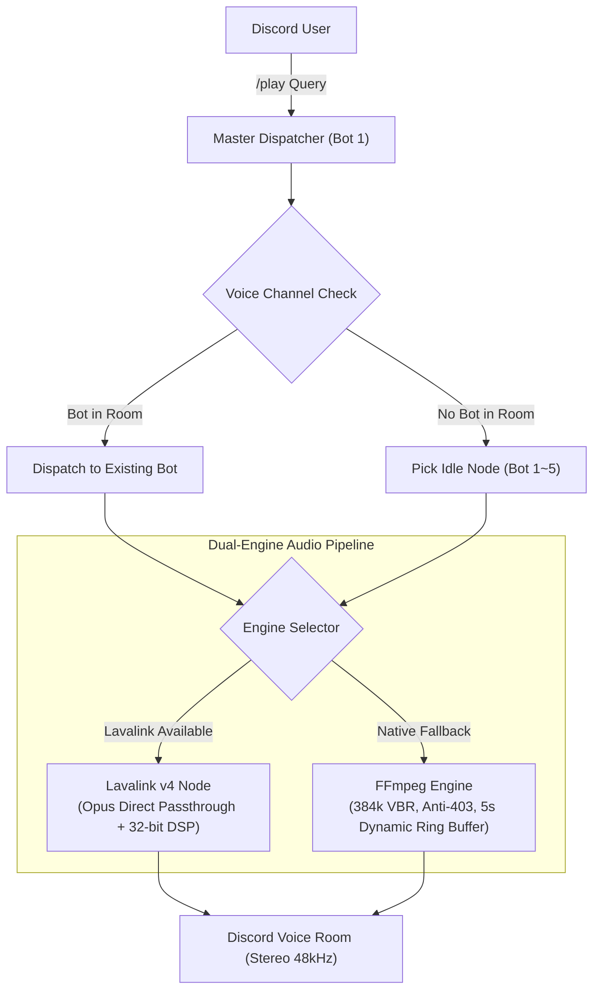

# DJ Donut — Discord Multi-Room Music Bot

<div align="center">


**A lightweight, multi-room Discord music bot cluster.**  
Run 1 to 5 bot instances inside a single Python process to stream music into multiple voice channels simultaneously, each with independent queues and audio controls.

[Bot Invitations](#bot-invitations) • [Features](#features) • [Slash Commands](#slash-commands) • [Quick Start](#quick-start) • [Audio Tips](#audio-troubleshooting) • [Changelog](#changelog) • [Feedback](#support--feedback)

</div>

---

## Bot Invitations

You can invite the pre-hosted **DJ Donut** cluster directly to your server:

| Bot Node | Invite Link | Default Permissions |
| :--- | :--- | :--- |
| **DJ Donut 1** | [Invite Bot 1](https://discord.com/oauth2/authorize?client_id=1549028983641743462&permissions=8&integration_type=0&scope=bot) | Administrator (`permissions=8`) |
| **DJ Donut 2** | [Invite Bot 2](https://discord.com/oauth2/authorize?client_id=1549258600155979956&permissions=8&integration_type=0&scope=bot) | Administrator (`permissions=8`) |
| **DJ Donut 3** | [Invite Bot 3](https://discord.com/oauth2/authorize?client_id=1549259098761990184&permissions=8&integration_type=0&scope=bot) | Administrator (`permissions=8`) |
| **DJ Donut 4** | [Invite Bot 4](https://discord.com/oauth2/authorize?client_id=1549259563646062743&permissions=8&integration_type=0&scope=bot) | Administrator (`permissions=8`) |
| **DJ Donut 5** | [Invite Bot 5](https://discord.com/oauth2/authorize?client_id=1549259919696592976&permissions=8&integration_type=0&scope=bot) | Administrator (`permissions=8`) |

> 💡 **How Multi-Room Dispatch Works**:
> When someone runs `/play` in any voice room, the dispatcher checks who is already in that channel. If none of the bots are in that room yet, it automatically grabs an idle bot and joins. If all 5 bots are invited to your server, up to 5 voice rooms can listen to completely different music at the same time.

---

## Features

- **Multi-Room Clustering**: Run up to 5 bots under a single process or game panel. Each voice room gets its own independent queue, volume, loop setting, audio filters, and progress tracker.
- **Dual-Engine Audio Pipeline**:
  - **Lavalink v4**: Connects to an external Lavalink node for high-throughput Opus passthrough and real-time DSP equalizers.
  - **Native FFmpeg Engine**: Runs natively without extra server software. Includes a dynamic ring buffer (`BufferedAudioSource`), custom stream headers to bypass YouTube 403 errors, and CPU thread capping (`-threads 1`).
- **Multi-Platform Support**: Paste links directly from YouTube, SoundCloud, Spotify (tracks, albums, playlists), Apple Music, and NetEase Cloud Music (including `163cn.tv` shortlinks).
- **Smooth Audio Streaming**: Decouples audio decoding from Discord voice transmission using a 5-second ring buffer to prevent playback jitter, sudden fast-forwarding, or audio dropouts.
- **Full Queue & Playback Control**: Jump to specific timestamps with `/seek`, randomize the queue with `/shuffle`, drop unwanted tracks with `/remove`, or wipe the list with `/clear`.
- **Interactive Controller UI**: Real-time progress bar (`01:23 ━━━━━━🔘─────── 04:29`), platform-themed embed cards, and a 10-button controller for volume adjustments, seeking, looping, and lyrics.
- **Synchronized Lyrics**: Fetch synchronized or plain-text lyrics on the fly via LRCLIB and NetEase without needing third-party API keys.
- **Server Settings Persistence**: Volume levels, language preferences, 24/7 mode, bass boost, and audio filters are saved per-server in `guild_settings.json` and persist across bot reboots.
- **Smart Autoplay**: Enable `/autoplay` to keep the music playing with stylistic recommendations once the queue finishes.
- **Multilingual Support**: Supports English, Traditional Chinese, Simplified Chinese, Japanese, Korean, and Spanish. Automatically detects each user's client locale.
- **Lightweight Footprint**: Typically runs within 80–120 MB RAM even with all 5 nodes active.

---

## Slash Commands

| Command | Arguments | Description | 說明 (繁體中文) |
| :--- | :--- | :--- | :--- |
| **/help** | *None* | Interactive manual categorized by features | 查看現代化分類指令使用指南 |
| **/play** | `query`, `[bot_id]` | Play a track or playlist (auto-dispatches an idle bot or targeted bot 1~5) | 點歌（支援智慧歷史補全與自動分配） |
| **/search** | `query` | Search tracks and pick from interactive top-5 select menu | 搜尋歌曲並從前 5 首下拉選單中挑選播放 |
| **/seek** | `time` | Fast-forward or jump to a timestamp (e.g. `90` or `01:30`) | 精確跳轉當前歌曲播放進度 (支援秒數或分:秒) |
| **/move** | `from`, `to` | Move a queued track to a new position | 調整待播清單中指定歌曲的播放順序 |
| **/replay** | `[index]` | Replay a track from playback history | 一鍵重播歷史紀錄中的歌曲 (預設上一首) |
| **/shuffle** | *None* | Randomly shuffle all upcoming songs in the queue | 隨機打亂當前語音房的待播歌單順序 |
| **/remove** | `index` | Remove a specific track from the queue by its number | 移除待播清單中的指定序號歌曲 |
| **/clear** | *None* | Clear all upcoming songs from the queue | 一鍵清空當前語音房所有的待播歌曲 |
| **/history** | *None* | View the last 15 songs played in this room | 檢視最近播放過的歷史歌曲紀錄 |
| **/nowplaying**| *None* | Show track details, progress bar, and interactive buttons | 查看目前歌曲、即時進度條與控制器 |
| **/queue** | *None* | Show the upcoming track queue for your room | 查看你所在語音房的待播歌單隊列 |
| **/skip** | *None* | Skip the track currently playing in your room (DJ guarded) | 跳過你當前語音房的歌曲 (支援 DJ 權限) |
| **/stop** | `[force_all]` | Stop playback and disconnect the bot (or stop all bots) | 停止播放並退出語音房（或強制全部退出） |
| **/dj** | `[role]`, `[clear]` | Manage or view server DJ permission role | 設定、檢視或清除本伺服器 DJ 管理身分組 |
| **/autoplay** | *None* | Toggle smart autoplay radio mode when queue ends | 切換自動接歌模式 (歌單結束自動接續播放) |
| **/lyrics** | `[song]` | Look up synced or plain lyrics for current or queried track | 查詢當前或指定歌曲的動態/純文字歌詞 |
| **/bassboost** | `level` | Adjust bass boost (+4dB to +20dB) | 調整重低音增強強度 |
| **/filter** | `preset` | Apply audio filters (Rock, Pop, Vocal, Nightcore, 8D, etc.) | 套用等化器音效濾鏡 (搖滾/夜核/8D等) |
| **/bitrate** | `[kbps]` | Maximize the voice channel bitrate up to 384kbps | 查看或調整目前語音房的位元率 |
| **/status** | *None* | Live cluster dashboard for all 5 bot nodes | 查看各機器人的連線狀態、所在房間與負載 |
| **/247** | *None* | Toggle 24/7 permanent room presence | 切換 24/7 永久常駐語音房模式 |
| **/language** | `language` | Set server default language (en / zh-TW / zh-CN / ja / ko / es) | 設定伺服器預設語言 |
| **/engine** | *None* | View real-time audio pipeline and engine diagnostics | 查看雙引擎架構即時運作狀態與音訊規格 |

---

## Quick Start

### 1. Run with Python (Local or VPS)

1. **Clone the repository and install dependencies**:
   ```bash
   git clone https://github.com/asian0626/DJ-Donut.git
   cd DJ-Donut
   pip install -r requirements.txt
   ```
   *Make sure `ffmpeg` is installed on your system:*
   - **Ubuntu / Debian**: `sudo apt update && sudo apt install -y ffmpeg`
   - **macOS**: `brew install ffmpeg`
   - **Windows**: Download from [gyan.dev](https://www.gyan.dev/ffmpeg/builds/) and add to your PATH.

2. **Configure your tokens**:
   ```bash
   cp .env.example .env
   ```
   Open `.env` and fill in your Discord Bot token(s):
   ```env
   BOT_TOKEN_1=your_first_bot_token_here
   BOT_TOKEN_2=your_second_bot_token_here
   # Add up to BOT_TOKEN_5 if you want all 5 nodes
   ```

3. **Start the cluster**:
   ```bash
   python3 main.py
   ```

---

### 2. Run with Docker Compose

1. Set up your `.env`:
   ```bash
   cp .env.example .env
   # Add your BOT_TOKEN_1 ~ BOT_TOKEN_5
   ```

2. Launch the container:
   ```bash
   docker compose up -d --build
   ```

3. Check logs:
   ```bash
   docker compose logs -f
   ```

---

### 3. Pterodactyl Game Panel

1. Upload or git-clone the repo directly into your Pterodactyl server root folder.
2. Ensure your egg is using a **Python 3.10, 3.11, or 3.12** image with FFmpeg installed.
3. Add your tokens to `.env`.
4. Set the startup command to:
   ```bash
   python3 main.py
   ```
5. Click **Start**. All configured bot tokens will log in together within that single panel container.

---

## Audio Troubleshooting

If audio sounds muffled, muddy, or quiet, it is almost always due to Discord's built-in noise suppression filtering out music frequencies.

### 1. Disable Krisp Noise Suppression
Discord's noise gate is tuned for human speech and treats heavy bass, synth, or drums as background noise.
- **Desktop (PC / Mac)**:
  1. Open **User Settings** (gear icon) -> **Voice & Video**.
  2. Under **Noise Suppression**, select **None** (turn off Krisp).
  3. Turn off **Echo Cancellation** if music still cuts in and out.
- **Mobile (iOS / Android)**:
  Swipe up while connected to the voice room and toggle off **Noise Suppression**.

### 2. Maximize Room Bitrate (`/bitrate`)
Discord defaults new voice channels to 64 kbps. Run `/bitrate` while in your voice room to immediately raise the channel to your server's maximum allowable rate (up to 384 kbps for boosted servers).

---

## Architecture



- **Runtime**: Python 3.11+ asyncio
- **Discord Library**: `discord.py` 2.7+ with application slash command tree
- **Audio Engines**: Lavalink v4 (Wavelink 3.4+) & Native FFmpeg Transcoder
- **Extractor**: `yt-dlp` with thread-local caching and adaptive user-agents
- **Lyrics Engine**: LRCLIB (synced) & NetEase (plain fallback)
- **i18n**: Built-in 6-language locale detection (`en`, `zh-TW`, `zh-CN`, `ja`, `ko`, `es`)

---

## Changelog

### v1.2.0 (2026-10-15)
- **Interactive Search Menu**: Added `/search <query>` allowing users to search YouTube and pick tracks from an interactive Discord UI drop-down menu showing title, duration, and artist.
- **Queue Reordering**: Added `/move <from> <to>` to freely reposition songs inside the upcoming queue without restarting playback.
- **History Replay**: Added `/replay [index]` to quickly re-queue songs directly from room history.
- **DJ Permission Roles**: Added `/dj [role] [clear]` to configure dedicated DJ roles. When set, only DJs and server administrators can skip, stop, or clear the queue in shared rooms.
- **Smart Query Autocomplete**: Added autocomplete suggestions to `/play` with listening history matches and popular genre queries.
- **Memory & Resource Reclamation**: Implemented a 10-minute periodic task to automatically garbage-collect idle room states (> 30 mins) and added a 5-minute timeout to player views.
- **Playlist Stream Stability**: Resolved audio thread deadlocks and aligned User-Agent headers across yt-dlp and FFmpeg to prevent runaway skipping on long playlists.

### v1.1.0 (2026-10-15)
- **Dedicated Media Worker Pool**: Offloaded Spotify, NetEase, Apple Music, and yt-dlp metadata extraction to a 10-worker `ThreadPoolExecutor`, preventing the main asyncio event loop from stalling during heavy track resolution.
- **Extractor Caching**: Added thread-local `YoutubeDL` instances (`threading.local`) and a 30-minute in-memory stream URL cache to cut query resolution times and reduce memory allocations.
- **Queue Controls**: Added `/seek` (timestamp seeking in seconds or `mm:ss`), `/shuffle` (randomize current queue), `/remove` (delete track by index), `/clear` (wipe upcoming queue), and `/history` (view recently played tracks).
- **Auto-Recovery & Failure Breaker**: Added exponential backoff retries on broken stream connections, and an automatic circuit-breaker that pauses playback after 5 consecutive resolution failures to prevent infinite skip loops.
- **Settings Persistence**: Guild settings (default volume, language, 24/7 permanence, bass boost level, and audio filter) now save to `guild_settings.json` and persist across bot restarts.
- **Cleaner Shutdowns**: Implemented `__del__` cleanup on `BufferedAudioSource` to guarantee background reader threads and audio buffers terminate promptly when skipping or stopping tracks.

### v1.0.5 (2026-10-15)
- **Eliminated Audio Stutter & Speed Jumps**:
  - Implemented `BufferedAudioSource`, a 5-second dynamic ring buffer running on a separate worker thread to decouple network fetching from real-time Discord voice playback.
  - Replaced unstable YouTube clients with reliable `tv` and `web` player profiles, avoiding aggressive 50KB/s download throttling and sudden stream resets.
  - Tweaked FFmpeg stream options: set `-http_persistent 0` to avoid dead connections and extended probe durations (`analyzeduration 1000000`, `probesize 256k`) to prevent clock drift.

### v1.0.4 (2026-10-14)
- **Modernized Player Interface**: Added a dynamic scrubber bar (`01:23 ━━━━━━🔘─────── 04:29`), platform-themed color accents, and cleaner embed formatting.
- **10-Button Dual-Row Controller**: Replaced basic buttons with a compact dual-row controller supporting live volume adjustments (`-10%` / `+10%`), instant lyrics, queue views, replay, and loop mode toggling.
- **Cluster Status Dashboard**: Added `/status` dashboard showing active rooms, per-node playback info, and direct OAuth2 invite links for any offline or missing bots.
- **Interactive Help Menu**: Added `/help` command categorizing all playback, audio, and queue controls.

### v1.0.3 (2026-10-14)
- **NetEase Cloud Music Support**: Added direct support for NetEase songs, playlists, albums, and short URLs (`163cn.tv` / `163.lu`).
- **Apple Music Support**: Added metadata resolution for Apple Music song, playlist, and album links (`music.apple.com` / `apple.co`).
- **Batch Resolution**: Streamlined track importing for third-party playlists, queuing up to 200 songs smoothly.

### v1.0.2 (2026-10-14)
- **Fixed Variable Scope Bug**: Resolved an `UnboundLocalError` in `/play` caused by shadowed variable names.
- **In-Memory Spotify Token Cache**: Switched to `MemoryCacheHandler` to prevent file permission errors on read-only hosting environments.
- **Permission Cleanup**: Updated OAuth2 invite links to request administrator permissions (`permissions=8`) to prevent channel permission issues.

---

## Support & Feedback

If you encounter any bugs, playback issues, or have suggestions:

- **Email**: [ian986260903@a1365.pro](mailto:ian986260903@a1365.pro)
- **GitHub Issues**: [Open an Issue / Feature Request](https://github.com/asian0626/DJ-Donut/issues)
