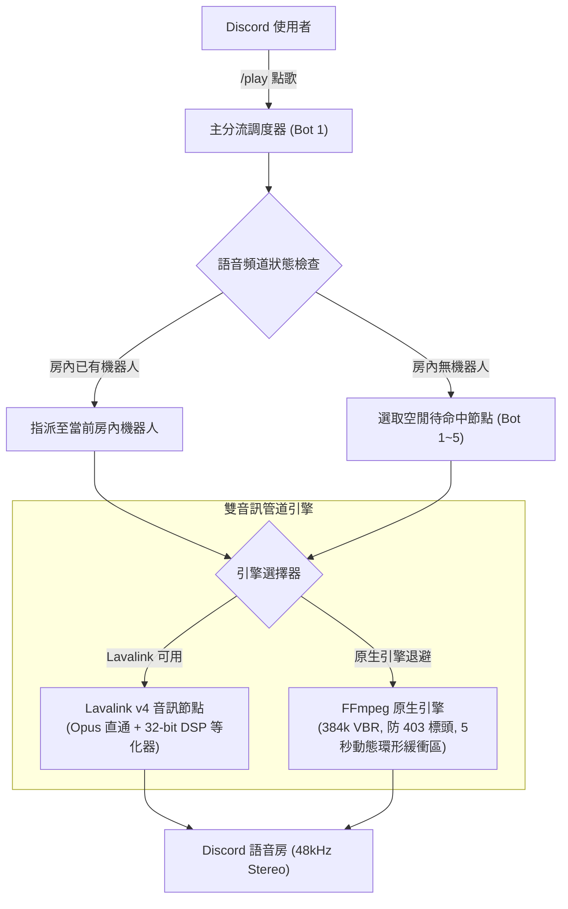

# DJ Donut — Discord 多房間音樂機器人叢集

<div align="center">

[](README.md)
[](README_zh-TW.md)


**輕量、高音質的 Discord 多房間音樂機器人矩陣**  
單一 Python 行程或遊戲面板即可同時運行 1 至 5 隻機器人，自動分流派發至不同語音頻道，各自享有獨立播放隊列、音量與等化器音效控制。

[機器人邀請連結](#-機器人邀請連結) • [特色功能](#-特色功能) • [斜線指令列表](#-斜線指令列表) • [快速開始](#-快速開始) • [聲音故障排查](#-聲音故障排查) • [系統架構](#-系統架構) • [更新日誌](#-更新日誌) • [支援與反饋](#-支援與反饋)

</div>

---

## 🤖 機器人邀請連結

您可以直接將預先架設好的 **DJ Donut** 叢集邀請至您的 Discord 伺服器：

| 機器人節點 | 邀請連結 | 預設權限 |
| :--- | :--- | :--- |
| **DJ Donut 1 號** | [邀請 1 號機器人](https://discord.com/oauth2/authorize?client_id=1549028983641743462&permissions=2150648832&integration_type=0&scope=bot+applications.commands) | 最小必要權限（檢視頻道、發送訊息、嵌入連結、連接語音、說話、應用程式指令） |
| **DJ Donut 2 號** | [邀請 2 號機器人](https://discord.com/oauth2/authorize?client_id=1549258600155979956&permissions=2150648832&integration_type=0&scope=bot+applications.commands) | 最小必要權限（同上） |
| **DJ Donut 3 號** | [邀請 3 號機器人](https://discord.com/oauth2/authorize?client_id=1549259098761990184&permissions=2150648832&integration_type=0&scope=bot+applications.commands) | 最小必要權限（同上） |
| **DJ Donut 4 號** | [邀請 4 號機器人](https://discord.com/oauth2/authorize?client_id=1549259563646062743&permissions=2150648832&integration_type=0&scope=bot+applications.commands) | 最小必要權限（同上） |
| **DJ Donut 5 號** | [邀請 5 號機器人](https://discord.com/oauth2/authorize?client_id=1549259919696592976&permissions=2150648832&integration_type=0&scope=bot+applications.commands) | 最小必要權限（同上） |

> 💡 **多房間分流派發機制運作方式**：  
> 當使用者在任一語音房輸入 `/play` 點歌時，系統調度器會先檢查當前語音房內是否已有正在服務的機器人。若尚無機器人進駐，系統會自動抓取一台處於空閒待命中的機器人進房播放。如果伺服器中已邀請全數 5 隻機器人，最多可讓 5 個不同語音房同時聆聽完全不同的音樂！

---

## ✨ 特色功能

- **多房間叢集矩陣**：單一進程或面板容器即可託管多達 5 台機器人，各房間隊列、音量、循環模式、音效濾鏡與進度計時完全獨立，互不干擾。
- **雙音訊引擎無縫切換**：
  - **Lavalink v4**：連接外部高效能 Lavalink 音訊節點，實現零損耗 Opus 直通與即時 32-bit DSP 等化器。
  - **極限調校原生 FFmpeg 引擎**：免額外軟體即可本機原生運行。內建 5 秒動態環形緩衝區（`BufferedAudioSource`）、防 YouTube 403 偽裝標頭、CPU 單執行緒限制（`-threads 1`）與飢餓逾時防死鎖機制。
- **全方位跨平台點歌**：支援 YouTube、SoundCloud、Spotify（單曲、專輯、播放清單）、Apple Music、網易雲音樂（包含 `163cn.tv` 短連結）等直接貼上網址或關鍵字點播。
- **超流暢抗抖動串流**：音訊解碼與 Discord 語音發送完全非同步解耦，透過緩衝區隔離網路波動，徹底告別音訊斷續、加速快進與發音卡頓。
- **精準播放與隊列控制**：支援 `/seek` 指定時間跳轉、`/shuffle` 隨機打亂、`/move` 調整順序、`/remove` 刪除指定序號、`/clear` 一鍵清空隊列。
- **現代化互動式控制器**：即時動態時間進度條（`01:23 ━━━━━━🔘─────── 04:29`）、平台專屬主題配色卡片，以及 10 鍵雙排控制器（音量調節、跳轉、循環、歌詞、最愛收藏）。
- **即時動態卡拉 OK 歌詞**：整合 LRCLIB 與網易雲音樂歌詞庫，自動解析 LRC 時間軸，於控制面板顯示滾動歌詞，無需申請第三方 API 金鑰。
- **資料庫 WAL 模式持久化**：音量、語言設定、24/7 模式、重低音與等化器全面保存於非阻塞 SQLite (WAL) 資料庫（`data/donut.db`），且具備崩潰重啟時自動恢復中斷隊列功能。
- **智慧自動接歌電台 (Autoplay)**：開啟 `/autoplay` 後，歌單播畢時將自動根據 Last.fm 相似歌曲推薦（支援 `LASTFM_API_KEY`）與 YouTube 演算法自動接續播放，派對永不冷場。
- **專業級系統監控端點**：內建輕量 HTTP 伺服器，於 `127.0.0.1:8080` 提供 `/healthz`（存活檢查）、`/metrics`（Prometheus 監控指標）與 `/status`（JSON 叢集狀態）。
- **完整多國語言支援 (i18n)**：內建繁體中文、簡體中文、英文、日文、韓文、西班牙文共 6 國語言，可自動依照使用者用戶端語言切換。
- **超低記憶體佔用**：輕量級極限調校，即便 5 台節點同時全速運作，記憶體佔用通常僅約 80–120 MB。

---

## 📜 斜線指令列表

| 斜線指令 | 參數 | 功能說明 |
| :--- | :--- | :--- |
| **/help** | *無* | 互動式使用指南與功能分類說明 |
| **/play** | `query`, `[bot_id]` | 智能點播歌曲或歌單（自動調度空閒機器人或指定 1~5 號機） |
| **/search** | `query` | 搜尋歌曲並從互動式前 5 首選單中挑選播放 |
| **/pause** | *無* | 暫停當前語音房的音樂播放 |
| **/resume** | *無* | 繼續播放已暫停的音樂（支援長時間暫停之串流重錨） |
| **/seek** | `time` | 跳轉至指定播放時間（例如：`90` 或 `01:30`） |
| **/move** | `from`, `to` | 調整待播清單中指定歌曲的播放順序 |
| **/replay** | `[index]` | 從歷史紀錄中重播歌曲 |
| **/shuffle** | *無* | 隨機打亂當前語音房所有的待播歌曲順序 |
| **/remove** | `index` | 從待播清單中移除指定序號的歌曲 |
| **/clear** | *無* | 一鍵清空當前語音房所有的待播歌曲隊列 |
| **/history** | *無* | 檢視當前語音房最近播放過的 15 首歷史紀錄 |
| **/favorite** | `action`, `[index]` | 管理個人最愛收藏清單（`play` 播放、`list` 檢視、`add` 新增、`remove` 移除、`clear` 清空） |
| **/nowplaying**| *無* | 查看當前歌曲詳情、動態動態歌詞、進度條與互動控制器 |
| **/queue** | *無* | 查看待播歌單（支援分頁按鈕互動翻頁瀏覽） |
| **/skip** | *無* | 跳過當前語音房正在播放的歌曲（具 DJ 權限保護） |
| **/stop** | `[force_all]` | 停止播放並讓機器人退出語音房（可選全體停止） |
| **/dj** | `[role]`, `[clear]` | 設定、檢視或清除本伺服器的 DJ 管理身分組 |
| **/autoplay** | *無* | 開啟或關閉智慧自動接歌電台模式 |
| **/lyrics** | `[song]` | 查詢當前或指定歌曲的即時動態/純文字歌詞 |
| **/bassboost** | `level` | 即時無縫調整重低音增強（`+4dB` 至 `+20dB`） |
| **/filter** | `preset` | 即時套用音效濾鏡（搖滾、流行、人聲清晰、Nightcore、8D 環繞等） |
| **/bitrate** | `[kbps]` | 查看或一鍵將當前語音頻道提升至最高位元率（最高 384kbps） |
| **/status** | *無* | 查看所有機器人節點的連線、負載與分流狀態儀表板 |
| **/247** | *無* | 切換機器人 24/7 永久常駐語音房模式 |
| **/language** | `language` | 設定本伺服器的預設語言（`en` / `zh-TW` / `zh-CN` / `ja` / `ko` / `es`） |
| **/engine** | *無* | 查看目前音訊引擎運作狀態與診斷資訊 |

---

## 🚀 快速開始

### 1. 使用 Python 本機或 VPS 部署

1. **複製儲存庫並安裝相依套件**：
   ```bash
   git clone https://github.com/asian0626/DJ-Donut.git
   cd DJ-Donut
   pip install -r requirements.txt
   ```
   *請確保系統已安裝 `ffmpeg`：*
   - **Ubuntu / Debian**：`sudo apt update && sudo apt install -y ffmpeg`
   - **macOS**：`brew install ffmpeg`
   - **Windows**：至 [gyan.dev](https://www.gyan.dev/ffmpeg/builds/) 下載並加入系統環境變數 PATH。

2. **配置環境變數**：
   ```bash
   cp .env.example .env
   ```
   編輯 `.env` 檔案並填入您的 Discord Bot Token：
   ```env
   BOT_TOKEN_1=你的第1隻機器人Token
   BOT_TOKEN_2=你的第2隻機器人Token
   # 若需要啟動更多節點，可依序填寫至 BOT_TOKEN_5
   ```

3. **啟動機器人叢集**：
   ```bash
   python3 main.py
   ```

---

### 2. 使用 Docker Compose 部署

1. 設定 `.env` 檔案：
   ```bash
   cp .env.example .env
   # 填入 BOT_TOKEN_1 ~ BOT_TOKEN_5
   ```

2. 啟動容器：
   ```bash
   docker compose up -d --build
   ```

3. 檢視即時日誌：
   ```bash
   docker compose logs -f
   ```

---

### 3. 使用 Pterodactyl 翼手龍遊戲面板部署

1. 將本專案檔案直接上傳或透過 Git 複製到面板根目錄。
2. 確認面板環境使用的是已內建 FFmpeg 的 **Python 3.10、3.11 或 3.12** 映像檔。
3. 建立並編輯 `.env` 填入 Token。
4. 將啟動指令（Startup Command）設定為：
   ```bash
   python3 main.py
   ```
5. 點擊 **Start**，所有配置的機器人將在單一容器內同時連線就緒。

---

## 🎧 聲音故障排查

若音樂聽起來有悶音、破音、低音被切除或音量忽大忽小，通常是 Discord 內建的語音降噪功能將音樂誤判為背景噪音所導致。

### 1. 關閉 Krisp 降噪功能
Discord 的噪音抑制演算法專為人類說話調校，會將重低音、電子音效或鼓聲當作噪音過濾掉：
- **電腦端 (Windows / macOS)**：
  1. 點擊左下角 **使用者設定**（齒輪圖示）-> **語音及視訊**。
  2. 找到 **噪音抑制 (Noise Suppression)**，將其切換為 **關閉 (None)**。
  3. 若音樂仍會斷續，可一併關閉 **回音消除 (Echo Cancellation)**。
- **手機端 (iOS / Android)**：
  在已連接語音房的介面向上滑動，將 **噪音抑制** 關閉。

### 2. 最大化頻道位元率 (`/bitrate`)
Discord 預設語音房位元率僅為 64 kbps。請在語音房內執行 `/bitrate`，機器人會立即將頻道音質拉滿至伺服器等級上限（加成伺服器最高可達 384 kbps 立體聲）。

---

## 🏗️ 系統架構



- **運行環境**：Python 3.11+ asyncio
- **Discord 函式庫**：`discord.py` 2.7+ (含完整 Application Slash Command Tree)
- **音訊核心**：Lavalink v4 (`wavelink` 3.4+) 與極限原生 FFmpeg Transcoder
- **音源解析**：`yt-dlp` 搭配執行緒區域快取與動態 User-Agent 偽裝
- **歌詞引擎**：LRCLIB（動態歌詞）與網易雲音樂（純文字備援）
- **多國語言**：內建 6 國語言自動偵測 (`en`, `zh-TW`, `zh-CN`, `ja`, `ko`, `es`)

### 專案結構說明

```
DJ-Donut/
├── main.py              # 叢集啟動入口與節點初始化矩陣
├── bot.py               # 備用啟動腳本
├── settings.py          # 環境變數、音效預設值、正規表達式與例外類別
├── cache.py             # 具 TTL 上限之串流網址與平台資訊快取
├── ytdl.py              # 限制工作執行緒之 yt-dlp 執行緒池 (run_media)
├── httpclient.py        # 全域非阻塞 aiohttp 連線池管理
├── storage.py           # 非阻塞 SQLite (WAL) 資料持久化與隊列快照
├── metrics.py           # Prometheus /metrics、/healthz 與 /status 監控伺服器
├── utils.py             # 時間格式轉換與 FFmpeg 濾鏡指令生成器
├── config.py            # 向後相容相依匯出層
├── locales/             # 6 國語言外部化 JSON 翻譯字典
├── tests/               # Pytest 自動化單元測試套件
├── core/
│   ├── models.py        # Song、GuildMusicState 與 BufferedAudioSource 定義
│   ├── player.py        # 音訊播放管道核心與 play_next 播放迴圈
│   ├── dispatcher.py    # 語音房配對與多機器人分流派發邏輯
│   └── node.py          # MusicNodeBot 客戶端定義與叢集生命週期
├── platforms/
│   ├── youtube.py       # 串流網址提取與智慧自動接歌演算法
│   ├── spotify.py       # Spotify 解析、oEmbed 與官方 API 轉換
│   ├── netease.py       # 網易雲單曲、專輯與歌單解析
│   └── apple_music.py   # Apple Music 元數據與專輯封面抓取
├── ui/
│   ├── embeds.py        # 播放卡片、進度條與時長格式化
│   └── views.py         # 10 鍵動態音樂控制器與分頁選單
├── commands/
│   ├── music.py         # /play, /search, /skip, /stop, /queue, /move 等指令
│   ├── audio.py         # /seek, /bassboost, /filter, /bitrate, /engine 等指令
│   └── admin.py         # /status, /help, /dj, /shuffle, /lyrics, /language 等指令
├── i18n.py              # 多語系解析與動態字串替換
└── lyrics.py            # 動態卡拉 OK 歌詞解析與提供器
```

---

## 📝 更新日誌

### v1.7.1 (2026-11-11)
- **音訊解碼 CPU 限制 (-threads 1) 與靜音飢餓防護**：於 `get_ffmpeg_options` 正式強制加入 `-threads 1`，避免多機器人併發時造成伺服器 CPU 尖峰。在 `BufferedAudioSource` 實作連續 300 幀（約 6 秒）飢餓逾時保護，防止網路瞬斷導致播放器永久卡在無聲狀態。
- **Discord UI 互動逾時安全處理**：為 `QueuePaginationView`（歌單翻頁）與 `SearchSelectView`（搜尋下拉選單）實作 `on_timeout`，逾時後自動將所有按鈕/選單反灰並刷新 Discord 介面，徹底消除 `Interaction failed` 報錯。
- **`/seek` 時間跳轉即時刷新**：跳轉成功後立即重新渲染控制器 Embed 卡片，無需等待 15 秒輪詢即可同步最新時間軸。
- **多節點外部 Lavalink 支援 (`FORCE_LAVALINK`)**：新增 `FORCE_LAVALINK=1` 環境變數開關，讓自建大型 Lavalink 節點的使用者在多機叢集下仍可保留 Opus 直通。
- **SQLite WAL 自動收縮與清理**：設定 `PRAGMA wal_autocheckpoint=1000` 並在服務關閉時執行 `PRAGMA wal_checkpoint(TRUNCATE)`，避免臨時日誌檔無限制膨脹。
- **Sentry 生產環境崩潰監控**：新增 `SENTRY_DSN` 支援，自動掛載 `AioHttpIntegration` 與 logging 處理器，為正式環境提供實時錯誤告警。
- **GitHub Actions CI/CD 自動化**：建立矩陣測試工作流程（支援 Python 3.10～3.12）、Ruff 代碼品質檢查與 Docker 建置驗證。

### v1.7.0 (2026-11-06)
- **安全強化 (TLS 驗證與最小權限)**：重新啟用 `yt-dlp` 與 Lavalink `/v4/info` 健康檢查的 TLS 憑證驗證；將邀請網址由管理員權限 (`8`) 精簡至最小必要權限 (`2150648832`)。
- **非阻塞 SQLite (WAL) 儲存與隊列恢復**：全面取代同步複寫 `guild_settings.json` 的舊機制，採用寫入佇列 SQLite 儲存庫；具備關機與定時快照功能，重啟後自動恢復各房間未播完之歌曲。
- **全專案型別安全與複雜度精簡 (`C901 <= 10`)**：全面重構指令處理器與播放迴圈，所有函式 McCabe 圈複雜度均小於等於 10，並全數通過 `mypy` 型別檢查。
- **隊列容量上限、冷卻時間與 Last.fm 接歌**：新增 `MAX_QUEUE_SIZE`、使用者指令冷卻時間、連續失敗指數退避與 Last.fm 相似歌曲接歌支援。

---

## 💬 支援與反饋

若您在使用過程中遇到任何問題、錯誤或有新功能建議：

- **電子郵件**：[ian986260903@a1365.pro](mailto:ian986260903@a1365.pro)
- **GitHub Issues**：[提交 Issue 或功能建議](https://github.com/asian0626/DJ-Donut/issues)
